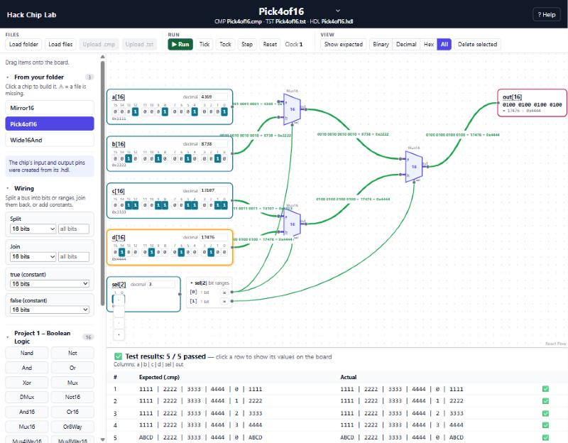

# Hack Chip Lab

**Live demo: https://arzhazima.github.io/hack-chip-lab/**

A web app for **building Nand2Tetris chips visually**: drag built-in chips onto a canvas, wire them
together, and check the result against the exercise's own `.tst` / `.cmp` files, with a ✅ / ❌ for every row.
Everything runs in your browser; nothing is uploaded anywhere.



_Pick4of16 (choose one of four 16-bit inputs) built from three Mux16 chips. The two bits of `sel` come from range handles on the pin itself, with no Split node. Binary / decimal / hex values are shown on the pins, and 5 / 5 test rows passed._

## Try it in 30 seconds

1. Open the [live demo](https://arzhazima.github.io/hack-chip-lab/).
2. Click **Load example chips** (no files needed).
3. Pick **WriteOnceRAM8** or **Pick4of16** from the big chip name at the top.
4. Wire it: drag chips from the left and connect them to the pins.
5. Press **Run**.

The examples are invented chips bundled in `public/examples/`; they load through the same code as a real folder.

## Quick start

You need [Node.js](https://nodejs.org/) (current LTS) and git.

```bash
git clone https://github.com/ArzHazima/hack-chip-lab.git
cd hack-chip-lab
npm install
npm run dev
```

Then open the address Vite prints (usually http://localhost:5173).

## What it does

- **Loads a folder of exercises** (`Name.hdl`, `Name.tst`, `Name.cmp`) and lets you pick a chip from a dropdown.
- **Creates the chip's pins for you** from the `IN` / `OUT` lines of its `.hdl` (names and widths; the `PARTS`
  section is ignored on purpose, so you build the implementation yourself).
- **Built-in chips** grouped by project: Boolean logic (Nand … DMux8Way), arithmetic (HalfAdder … ALU) and
  memory (DFF, Bit, Register, ARegister, DRegister, PC, RAM8 … RAM16K), drawn as real gate symbols. The built-in
  with the same name as the chip you are building is hidden, so you cannot build a chip out of itself.
- **Buses:** Split, Join and true / false constants (1–16 bits, single bits or ranges such as `0..7`). Most of the
  time you do not even need them: click a multi-bit pin, drag across the bits you want and wire from the new
  `[4..7]` handle.
- **Runs the chip's `.tst` against its `.cmp`** and shows a pass/fail table. Click a row to see its values on
  the board (wires turn green for 1, gray for 0). **Show expected** displays the `.cmp` table.
- **Values you can read:** pins and wires show their value in binary (grouped by 4 bits), decimal and hex; the
  toolbar's format switch chooses which. Input pins have clickable bit buttons next to the decimal box.
- **Project 5 blocks:** ROM32K (pick a loaded `.hack` program), Screen, Keyboard, Memory (RAM16K + Screen +
  Keyboard in the Hack address map), **CPU** and **Computer** (ROM + CPU + memory in one block that runs the chosen
  program, about 400,000 cycles per second). Load `.hack` files with **Load folder** / **Load files**. You can also
  build the Computer yourself from the ROM32K, CPU and Memory blocks. Not built yet: `.tst` access to A / D / PC, the
  screen and keyboard view (see `docs/ADR-R2-project5.md`).
- **Clock:** Tick / Tock / Step / Reset with a cycle counter and the stored value of every register chip (DFF, Bit, Register, PC ...).
- **Editing:** select a chip, pin or wire and press Delete / Backspace (or use **Delete selected**).
- **Autosave:** every chip keeps its own circuit in your browser's local storage.

## Load your exercises

Put each chip's three files in one folder, with the same base name:

```
my-exercises/
  Mux4Way16.hdl
  Mux4Way16.tst
  Mux4Way16.cmp
  Xor.hdl
  Xor.tst
  Xor.cmp
```

1. Click **Load folder** (or **Files…**, or just drag the folder onto the page).
2. Pick a chip in the dropdown. Its input and output pins appear on the board.
3. Build the circuit from the sidebar: built-in chips, and the **Wiring** section for buses.
4. Press **Run**.

A chip with a missing file is still listed, marked with ⚠ and the name of the missing file. Without a chip
selected you can still use the board manually: add pins from the sidebar and upload a `.cmp` with **Upload .cmp**.

## Tests

```bash
npm test          # all unit and end-to-end tests
npx tsc -b        # type check
npm run build     # type check + production build
```

The chips under `tests/fixtures/` are invented for the tests. A local `examples/` folder for real course
files is ignored by git on purpose.

## Known limitations

- **No CPU, Memory or Computer yet:** there is no ROM, screen or keyboard, and `.hack` programs cannot be loaded.
- **Sequential support is basic:** DFF, Bit, Register, ARegister, DRegister, PC and the RAM chips work with
  Tick / Tock / Step and `tick` / `tock` / `ticktock` in `.tst` scripts, but a `.tst` cannot read or set a chip's
  internal state (`RAM16K[0]`, `PC[]`).
- **No reusable chips:** you cannot save your own circuit and use it as a chip inside another one.
- **Only the `.hdl` interface is read**, never its implementation.
- **Only a subset of `.tst`** is supported (`set`, `eval`, `tick`, `tock`, `ticktock`, `output`, `output-list`,
  `repeat`); other commands are skipped with a warning, and bus indexing such as `set a[0] 1` is an error.
- **Every pin and bus is at most 16 bits wide.**
- **Bit ranges on pins cannot be edited:** delete the range (`×`) and add a new one. Split / Join settings
  likewise cannot be edited after you drop the node (delete it and drop a new one).
- Very large circuits and very long result tables are not optimized yet.
- Tested only in a Chromium-based browser.

## Roadmap

No dates; these are ideas in rough priority order, and none of them has been started.

1. **Reusable chips:** save a circuit you built and use it as a chip inside other circuits.
2. **Memory, CPU and Computer:** ROM with a loadable `.hack` program, screen and keyboard, and `.tst` access to
   internal chip state. This also needs a faster evaluation engine.
3. **HDL export:** write the circuit you built back out as a `.hdl` file.
4. UI polish and performance for large circuits.

## License

MIT, see [LICENSE](LICENSE). Changes are listed in [CHANGELOG.md](CHANGELOG.md).
